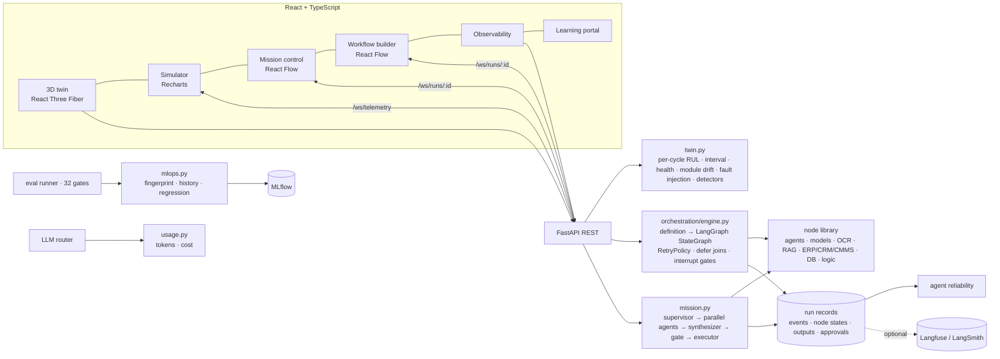
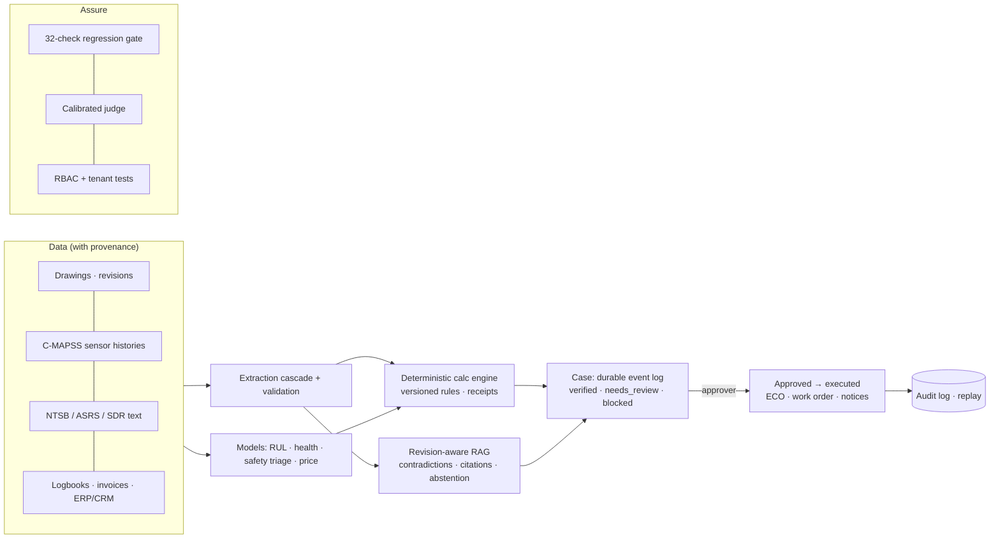
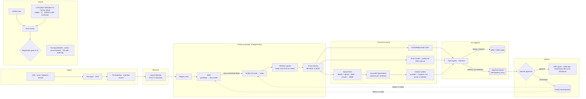

# Architecture

## Version 2 additions

**Workflow compilation.** One trigger maps to `START`, leaves to `END`, fan-out edges run in parallel, nodes with several
inbound edges become deferred joins, conditions route along `true`/`false` edges, and approval steps call `interrupt()`. Each
step has a `RetryPolicy` for transient errors and an `on_error` policy (stop or continue). Validation refuses cycles,
disconnected steps, extra triggers, unlabelled branches and any write or external step reachable without an approval.

**Approvals.** A one-time token is issued per checkpoint and shown only to approvers. The engine also checks the role and that
the approver is a named human, and can enforce separation of duties and an expiry. Decisions go to the audit log, and a
replayed token is rejected.

**Test, replay and compare.** Test batches run in a sandbox (fresh ERP/CRM/CMMS and an in-memory case store) with a
simulated reviewer. They are scored against ground truth: C-MAPSS true RUL, NTSB fatal labels, revision-pair severity and
golden drawing fields. Replays re-execute a recorded definition, payload and fault settings, and the comparison diffs every
step with volatile identifiers stripped.

## Platform view (AeroNexus)

The detailed drawing-extraction path is below.

## Request path for one drawing (latency budget)

| Stage | Typical cost | Why it's ordered this way |
|---|---|---|
| Layout + regex + NER | ~2 ms CPU (measured p95 on the golden set) | Deterministic, auditable, free. Resolves all but 1–2 of the 13 fields on most sheets. |
| LLM fallback (small model) | hundreds of ms for a local 3B model (estimate; measure with your provider) | Only for fields the rules can't read (title, odd layouts). One call per sheet, all missing fields batched. |
| Escalation to large model | seconds (estimate) | Only when the small model's confidence < 0.60 or its JSON fails validation. |
| Retrieval + grounded rationale | ~5 ms retrieval; LLM time as above | Cached per (model, normalized prompt). |
| Verification | < 1 ms lexical (measured); NLI adds a cross-encoder pass per sentence (not measured here) | Cheap enough to run on every answer. |

Levers, in the order they pay off: **cascade** (most fields never touch an LLM) → **batching** (one LLM call per
sheet) → **cache** (repeat drawings and FAQ chat are free) → **small-first routing** → **pixel caps for VLMs**
(`max_pixels` in notebook 02 bounds tokens per drawing) → **async workers** for uploads (uvicorn workers today; a queue
such as Celery/RQ when volume needs it).

## Trade-offs we chose deliberately

- **Wrong is worse than missing.** Rules refuse half-readable numbers ("12O") instead of guessing, so the field goes to
  review. The gate enforces ≥ 98% precision and ≥ 99% auto-accept precision even if recall suffers.
- **Rules before models.** Less impressive in a demo, far more reliable and cheaper in production; the LLM is a
  fallback with a verbatim guard, not the main reader.
- **Lexical verifier by default, NLI optional.** The lexical check (numbers must match + content recall) is strict and
  instant but misses paraphrase; NLI catches paraphrase at the cost of a model download and a forward pass per sentence. Both share one interface.
- **In-memory stores in the repo.** Swappable behind `services()` for Postgres + pgvector, Redis cache and a real
  ERPNext (`ERPNextAdapter`) without touching modules.
- **The judge is not trusted by default.** It must clear the human–human agreement bar (kappa, with CI) before it may
  gate releases; until then humans stay in the loop and the harness reports *why*.

## Failure behaviour

| Failure | What happens |
|---|---|
| LLM provider down / slow | Retries with backoff → circuit opens after 5 failures → system runs rules-only, LLM fields go to review, chatbot falls back to extractive answers. UI shows "paused, rules only". |
| Model returns invalid JSON | One repair round-trip, then the field is left for review. |
| Model invents a value | Discarded (not on the sheet), counter `extract.llm.hallucination_blocked`. |
| Document contains instructions to the AI | LLM fallback disabled for that document, no actions drafted, flagged as a security issue. |
| Retrieved passage contains instructions | Passage quarantined before it reaches a prompt. |
| Duplicate approval click | Idempotency key — executes once. |
| Traffic spike | Token-bucket rate limit (429) protects the model budget. |
